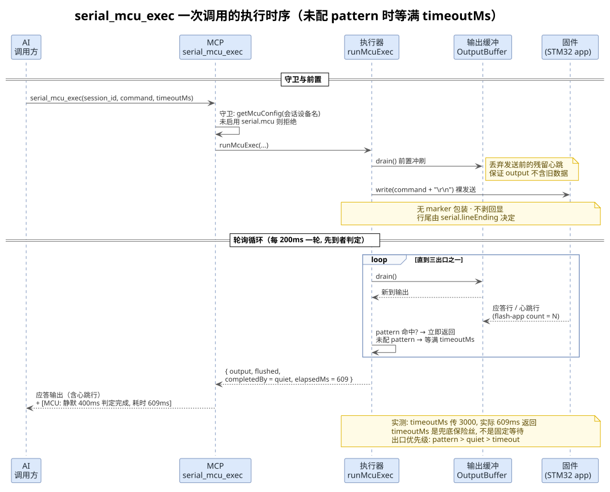
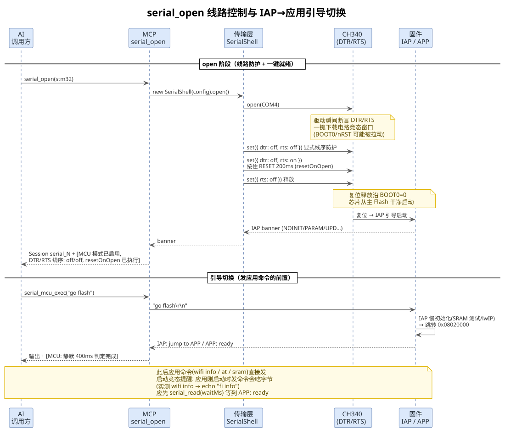

<!-- more -->

## 一、 背景与设计目标

MCP 串口通道原有的 `serial_exec` 面向 **Linux shell 会话**设计，其完成判定体系建立在三个前提上：

（1）设备有 shell，能解析并执行 `; echo "MARKER:$?"` 这类包装语法（1 级 marker 检测）；

（2）PTY 会回显，首行"提示符 + 命令回显"可以被剥离（echo strip）；

（3）命令结束后提示符会回来，能用末尾锚定正则判定（2 级提示符检测）。

单片机裸固件（如 STM32 应用 + 周期心跳打印）三条全不成立：

- 固件不解析 shell 语法，marker 包装会被当作**数据**原样发给固件（可能误触发动作）
- 无回显，回显剥离会把真实的首行响应吞掉
- 无提示符，提示符检测永远无法命中，只能靠 5 分钟兜底超时

为此新增 **MCU 模式**：独立的 `serial_mcu_exec` 工具 + 独立的执行器 `runMcuExec`，与 shell 语义彻底分离，并用双向守卫保证路由。本文说明配置、工具体系、执行等待逻辑（重点）与线路控制的设计，实测数据均来自 2026-10-31 的 ATK 战舰 V3 类板卡（CH340 + STM32F103 + ESP8266）。

## 二、 配置设计（serial.mcu 子段）

### 1. 字段定义

配置收敛在设备配置 `serial` 段下的 `mcu` 子段（该模式只服务串口通道），子段存在且 `enabled: true` 即启用；Linux 板卡设备不写该子段即可，现有设备 yaml 一行不用改：

```yaml
# 分文件布局: devices/stm32.yaml（文件名即设备名）；单文件布局写在 devices.<设备名>.serial 下，写法相同
serial:
  port: "COM4"
  baudRate: 115200
  lineEnding: "\r\n"   # 沿用已有字段, 不在 mcu 中重复(避免双源歧义)
  mcu:
    enabled: true
    dtr: off              # open 后 DTR 电平: on | off | keep(不动, 默认)
    rts: off              # open 后 RTS 电平: 同上
    resetOnOpen: true     # open 后执行 DTR/RTS 软件复位时序拉起应用
    quietMs: 400          # 静默判定窗口(毫秒), 须小于固件心跳周期, 默认 400
    responsePattern: ""   # 可选: 响应完成正则(任意位置命中即判完成), 留空仅用静默判定
```

### 2. 单一判定入口 getMcuConfig()

所有 MCU 相关判断统一走 `getMcuConfig(deviceName)`（[`src/sdk/shared/config.ts`](../../src/sdk/shared/config.ts)）：

- 子段存在且 `enabled: true` → 返回规范化配置（`dtr/rts/resetOnOpen/quietMs` 已补默认值，`responsePattern` 已编译为正则）
- 否则返回 `undefined`（非 MCU 设备）
- 校验失败（quietMs 非正数、正则非法）直接抛错，调用点转为明确的配置错误提示

四个消费方全部走这一个入口：`serial_exec` 正向守卫、`serial_mcu_exec` 反向守卫、`serial_shell_login` 守卫、`serial_open` 线路控制。

## 三、 工具体系与路由守卫

### 1. 工具清单变化

| 工具 | 状态 | 说明 |
|---|---|---|
| `serial_mcu_exec` | 新增 | MCU 裸固件执行：裸发送 + 静默/响应特征判定 |
| `serial_exec` | 加守卫 | 命中 MCU 设备即拒绝并指路 |
| `serial_shell_login` | 加守卫 | MCU 设备返回教学提示（无 PSH 登录流程） |
| `serial_read` | 加参数 | 新增 `waitMs`（0-30000，默认 0）：等待后再读，供无回显设备手动轮询 |
| `serial_write` / `serial_send_ctrl` | 不变 | 本就是裸字节语义，MCU 会话直接可用 |

### 2. 双向守卫

| 调用方向 | 检查 | 行为 |
|---|---|---|
| MCU 设备调 `serial_exec` | `getMcuConfig` 命中 | 拒绝并指路 `serial_mcu_exec`（marker 包装/回显剥离对裸固件是破坏性的） |
| 非 MCU 设备调 `serial_mcu_exec` | `getMcuConfig` 未命中 | 拒绝并指路 `serial_exec`（裸发送/静默判定与 shell 会话不兼容） |
| MCU 设备调 `serial_shell_login` | `getMcuConfig` 命中 | 教学式提示：直接 open 后发命令，无需登录 |

实现要点：守卫判定用**会话自身的设备名**（`shell.getDeviceName()`），而非当前活跃设备——两者可能不一致（`DEVICE=board-a` 但操作 `stm32` 的会话），用活跃设备会漏判。守卫位于 handler 最先执行，拒绝时不开端口、不碰会话状态；错误文案直接指路正确工具，AI 调错一次即可自纠错。

## 四、 执行等待逻辑（runMcuExec）

### 1. 执行流程总览

执行器为独立模块 [`src/sdk/exec/mcu-exec-runner.ts`](../../src/sdk/exec/mcu-exec-runner.ts)，刻意不复用三通道共享的 `runExec`（避免扰动 adb/ssh 路径），复用其轮询骨架与 `OutputBuffer.drain()`：



一次调用的完整交互时序（含实测时间线）：



#### 1.1 runMcuExec()

单片机裸固件命令执行的核心函数，该函数在 [`src/sdk/exec/mcu-exec-runner.ts`](../../src/sdk/exec/mcu-exec-runner.ts) 文件中定义：

```ts
export async function runMcuExec(input: McuExecInput): Promise<McuExecResult>;
```

【**函数作用**】

向已打开的串口会话裸发送一条命令（无 marker 包装、无回显剥离），以 200ms 为周期轮询输出缓冲区，按 pattern 命中 / 静默期满 / 超时三个出口中先到者判定完成并返回收集到的输出。

【**参数含义**】

- `shell`：目标串口会话实例（`InteractiveShell`）
- `command`：裸命令字符串，执行器不做任何包装，行尾换行由 `serial.lineEnding` 配置决定
- `clear`：缓冲区清空标志，透传给 `shell.write`，默认 1
- `timeoutMs`：兜底超时（毫秒），未传时默认 10000
- `quietMs`：静默判定窗口（毫秒），须小于固件心跳周期
- `responseRegex`：编译后的响应完成正则，`null` 时仅用静默判定
- `logPrefix`：日志前缀

【**返回值**】

`McuExecResult`：`output`（发送时刻到出口之间的全部输出）、`flushed`（前置冲刷丢弃的残留，仅供诊断）、`completedBy`（`pattern` / `quiet` / `timeout`）、`elapsedMs`（实际耗时）。

### 2. 三个完成出口

#### 2.1 pattern：响应特征命中

每轮轮询将 `responseRegex` 对**累积输出**做任意位置匹配（非末尾锚定），首次命中立即返回。特征选择必须描述**应答结尾**而非应答开头——例如对 `wifi info` 应答以 `mac = ...` 结尾可配 `mac\s*=`；若配成回显特征 `APP: echo:` 会在应答刚开始时就截断。一个设备只有一个全局 pattern，而不同命令的应答格式各异，误配置风险大于收益时宁可留空。

#### 2.2 quiet：静默判定（默认路径）

距**最后一字节**（含心跳）静默满 `quietMs` 即判定完成。两个关键语义：

（1）计时器被任何新到字节重置——心跳落在窗口内会让完成点顺延到该心跳之后；因此 `quietMs` 必须小于固件心跳周期，应答后的空档才能凑满窗口。心跳周期约 1s、`quietMs` 400ms 的典型配置下，命令在应答后约 400-600ms 返回。

（2）**空响应也走此出口**：计时起点是发送时刻，命令发出后一直无数据，`quietMs` 到期即返回空输出——不会苦等 `timeoutMs`。

#### 2.3 timeout：兜底超时

耗满 `timeoutMs` 强制返回，语义为异常安全阀。**全程不发 Ctrl+C**：对单片机发 0x03 可能误触发固件动作（这一点与 `serial_exec` 的常驻采样超时"到点发 Ctrl+C"相反），超时类型在返回标注中明示"未发送中断"。

### 3. timeoutMs 的真实语义：保险丝而非定时器

常见误解是"传 N ms 就等 N ms"。实际 `timeoutMs` 只是**最坏情况的上限**，正常情况三个出口中前两个都会提前触发：

| 场景 | 实际耗时 | 出口 |
|---|---|---|
| 应答后安静（实测 `wifi info` 传 3000） | 609ms | quiet |
| 应答极快的 pattern 命中 | 应答到达即返回 | pattern |
| 命令无响应、线路安静 | ~quietMs + 轮询粒度 | quiet（空输出） |
| 心跳周期 < quietMs（刷屏型固件） | 等满 timeoutMs | timeout |

因此 `timeoutMs` 按命令**最坏耗时**估算即可（reboot 类给 4000 足够），平时轮不到它。反过来，若想要"固定采样 N 秒"的语义（故意收 N 秒心跳流），把 `quietMs` 配得比心跳周期小即可——输出不断、静默永不满足，自然收满 `timeoutMs`（离线测试第 6 组验证的行为）。

### 4. 与 serial_exec 双超时机制的对照

| 维度 | serial_exec（shell） | serial_mcu_exec（MCU） |
|---|---|---|
| 完成判定 | marker 注入 → 提示符锚定 → 内核启动早退 | pattern → quiet → timeout |
| 常驻命令分类 | 有（ping/logcat 走采样超时） | 无（固件命令无此概念） |
| 超时动作 | 常驻发 Ctrl+C / 普通不发 | **永不发** Ctrl+C |
| 回显处理 | 剥离首行 PTY 回显 | 无回显可剥（首行即真实响应） |
| 退出码 | marker 展开 `$?` 可得 | 无此概念 |
| 默认兜底 | 常驻 10s / 普通 5min | 10s |

返回标注风格保持一致：`[MCU: 响应模式命中, 耗时 Xms]`、`[MCU: 静默 Nms 判定完成, 耗时 Xms]`、`[MCU兜底超时: 已收集 Xms 输出, 未发送中断]`，漏传 `timeoutMs` 时追加反向引导提示。

## 五、 open 阶段的线路控制

### 1. DTR/RTS 线序防护

ATK 一键下载类板卡的 CH340 `DTR`/`RTS` 经三极管控制 `BOOT0`/`nRST`，打开端口瞬间驱动的断言电平存在"按复位/误入 ISP"竞态（实测能把芯片推进 ROM ISP 且断电重启都无法脱离）。`serial_open` 在物理串口 open 成功后立即执行 [`#applyMcuLineControl`](../../src/sdk/transports/serial.ts)（仅 MCU 设备携带线路参数时执行，非 MCU 设备跳过，行为与从前一致）。

### 2. resetOnOpen 复位时序

配置 `resetOnOpen: true` 时，open 后补一拍实测可靠的软件复位：按住 RESET（`DTR=off + RTS=on`）200ms 后释放（`RTS=off`）——复位释放沿 `BOOT0=0`，芯片从主 Flash 干净启动，即 MCU 版的"一键就绪"。执行细节与电路机理见 [DTR-RTS线序与STM32-ISP模式.md](LV075-DTR-RTS线序与STM32-ISP模式.md)。

open 阶段的完整交互时序（含 IAP→应用引导切换）：



## 六、 验证与使用要点

### 1. 离线测试

[`test/scripts/serial/mcu-exec-test.mjs`](../../test/scripts/serial/mcu-exec-test.mjs) 以 FakeShell 模拟"无回显固件 + 周期心跳 + 命令响应"输出流，19 项检查覆盖：pattern 命中且早于静默、心跳干扰下的静默判定、超时不发 Ctrl+C 契约、空响应静默完成、前置冲刷隔离、`quietMs` 大于心跳周期时退化为固定采样、裸发送契约（无 marker/无 shell 语法追加）。

### 2. 真板实测数据

| 命令 | timeoutMs | 实际耗时 | 出口 |
|---|---|---|---|
| `wifi info` | 3000 | 609ms | 静默 |
| `go flash` | 4000 | 617-623ms | 静默 |
| `reboot` | 4000 | 663ms | 静默 |
| `paramget` | 2000 | 613ms | 静默 |

全部提前返回，`timeoutMs` 未触顶。

### 3. 使用要点

（1）MCU 设备的使用流程只有两步：`serial_open` → `serial_mcu_exec`；要发应用命令时中间多一步 `go flash` + 等 `APP: ready`（取决于固件引导结构）。

（2）复位/跳转后固件可能仍在初始化，此时发命令有启动竞态（实测应用刚启动时 `wifi info` 被吃掉前两个字符，echo 成 `fi info`）。正确姿势：先 `serial_read(waitMs)` 等到就绪标志（如 `APP: ready`）再发首条命令。

（3）输出中混入的心跳行（`flash-app count = N`）需自行辨识；前置冲刷保证输出不含**发送前**的残留，但发送后的心跳会与响应并存。

（4）配置修改（`quietMs`/`responsePattern` 等）需重启 MCP 进程生效（配置进程内单例缓存）。

---

*本文档由 markdowncli 技能辅助生成*
